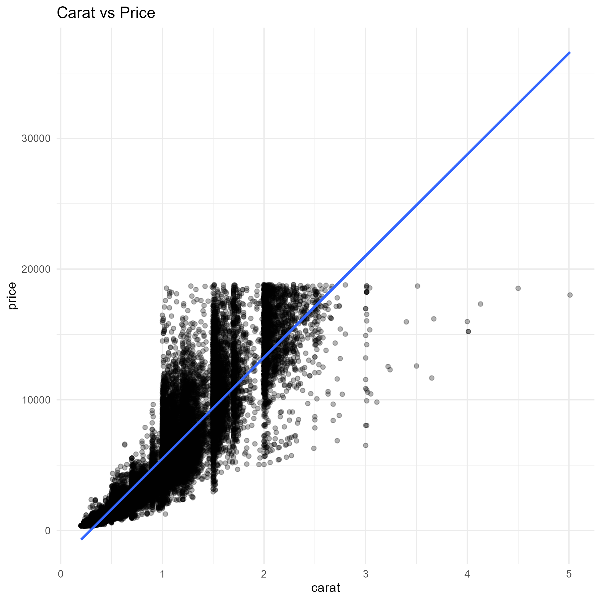
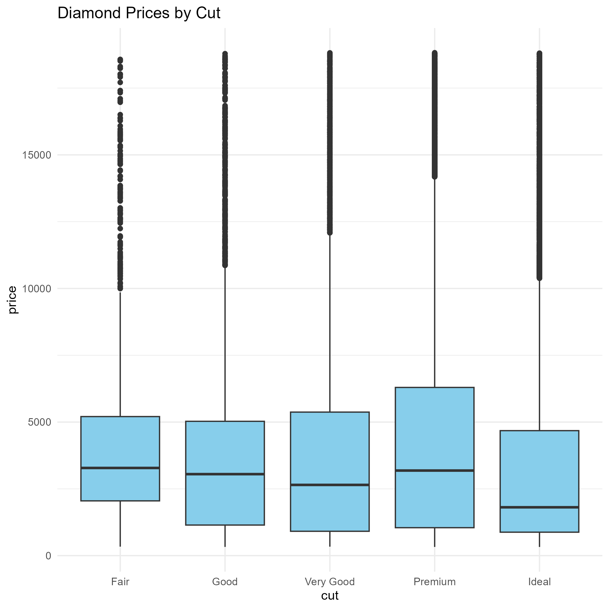

# R-Data-Analysis-Project
Exploratory data analysis of diamond prices using R, ggplot2 and data visualisation.

## Objectives
- Explore the distribution of product prices.
- Compare prices across different diamond cuts.
- Understand the relationship between carat weight and price.
- Identify pricing patterns using data visualisation.

## Dataset
- **Source:** Built-in `diamonds` dataset from the `ggplot2` R package.
- Contains information about diamond characteristics, including carat, cut, clarity and price.

## Tools and Technologies
- R
- RStudio
- ggplot2
- dplyr

## Analysis Performed
- Data inspection and summary statistics.
- Missing-value checks.
- Price distribution analysis.
- Comparison of price across diamond cuts.
- Relationship between carat weight and price.
- Visualisation using histograms, scatter plots and boxplots.

## Project Visualisations

### 1. Diamond Price Distribution

### 2. Carat vs Price

### 3. Price by Cut

