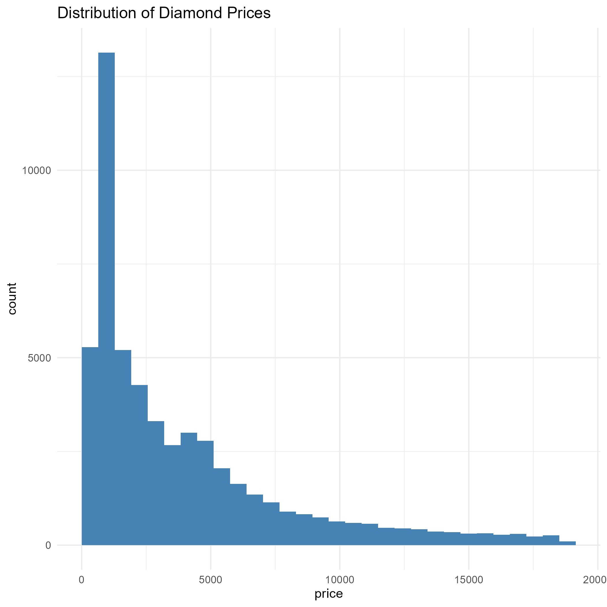

# R-Data-Analysis-Project
An exploratory data analysis project using R, focusing on product pricing, trends and visualisation.
## Project Visualisations

### 1. Diamond Price Distribution

### 2. Carat vs Price

### 3. Price by Cut

